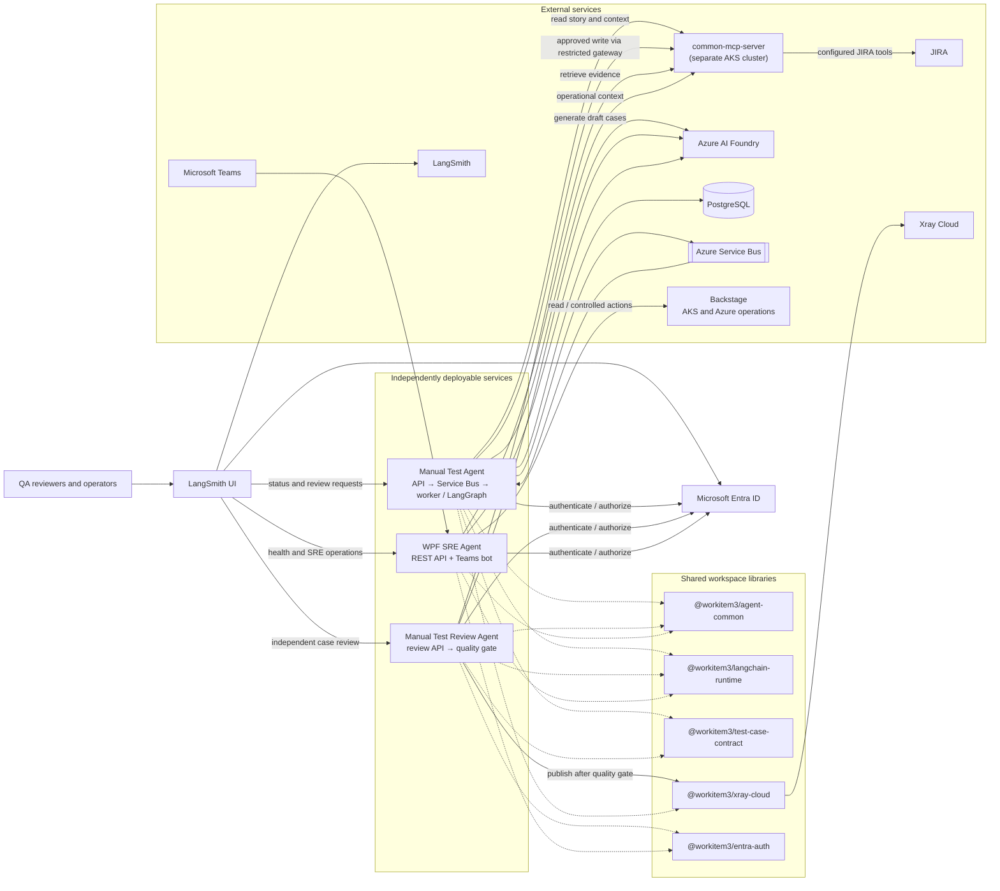

# Manual Testing Agents

This repository is an npm workspace containing independently deployable Node.js/LangChain services:

- [Manual Test Agent](./agents/manual-test-agent/README.md) generates structured test cases from JIRA stories.
- [Manual Test Review Agent](./agents/manual-test-review-agent/README.md) independently reviews a submitted test-case set.
- [wpf-sre-agent](./agents/wpf-sre-agent/README.md) reads Azure/AKS health and pod activity from Backstage, summarizes activity, and submits controlled pod restarts through Backstage.
- [LangSmith UI](./apps/langsmith-ui/README.md) authenticates users with Entra ID, shows live service health and latest LangSmith run state, and provides a human-review queue for generated test cases.
- [Shared agent libraries](./packages/agent-common/README.md) provide stable hashes, safe JSON persistence, redaction, resource validation, and sanitized logging.

## Architecture



Both services use `common-mcp-server` (Confluence/SharePoint) to collect requirement and product
context: the generator uses it to create test cases, while the independent reviewer researches the
story and proposed cases before returning its assessment. Set the required `MCP_SERVER_URL` and, if required,
`MCP_SERVER_TOKEN` for each service.

The services share `@workitem3/agent-common` for security and persistence primitives and
`@workitem3/langchain-runtime` for Azure AI Foundry and MCP integration,
`@workitem3/test-case-contract` for the versioned Zod request/response schema, and
`@workitem3/xray-cloud` for remote Xray Cloud test creation. They have separate
package entry points, Dockerfiles, AKS namespaces, and deployment manifests. The reviewer defaults to
the `claude-opus-4-1` Foundry deployment; the generator defaults to `claude-sonnet-4-5`. The reviewer
deployment/model configuration is separate. The generator does not call the reviewer; invoke
`POST /review` separately when a review is needed. The reviewer automatically creates the test cases
in remote Xray Cloud only if its checks pass; configure Xray credentials and region independently
for the reviewer service.

The LangSmith UI and both agent APIs use separate Entra app registrations. The dashboard uses
delegated scopes to read agent status, and retains the LangSmith API key on its server only. Configure
the required API scopes, tenant consent, tracing keys/projects, HTTPS origins, and agent URLs using
the [LangSmith UI deployment guide](./apps/langsmith-ui/README.md).
Dashboard app roles restrict DevOps to agent health/status and testers to generated-case review;
the protected agent APIs enforce the corresponding roles as well.
The independently deployable wpf-sre-agent integrates with configured Backstage routes, is visible
in the LangSmith dashboard, and exposes an Azure Bot messaging endpoint for the allowlisted
`WPF-DevOps-Channel`.

Install dependencies and run checks from the repository root:

```bash
npm install
npm run check
npm test
npm run build --workspace=@workitem3/langsmith-ui
```

Build either image independently from the repository root using its Dockerfile, then apply that
agent's `k8s/deployment.yaml`. Each agent README documents its configuration and deployment steps.
